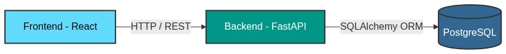
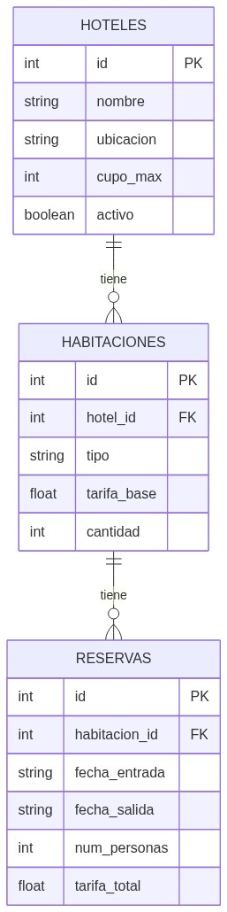

# Sistema de Reservas Hoteleras

Sistema web para consultar disponibilidad y tarifas de una cadena hotelera con sedes en Colombia.

## Diagrama de Arquitectura



Toda la aplicacion corre en contenedores Docker orquestados con `docker-compose`:

| Servicio   | Tecnologia       | Puerto |
|------------|------------------|--------|
| Frontend   | React + Vite     | 5173   |
| Backend    | FastAPI + Python  | 8000   |
| Base datos | PostgreSQL 15    | 5432   |

## Modelo de Base de Datos



### Relaciones

- Un **Hotel** tiene muchas **Habitaciones** (agrupadas por tipo).
- Una **Habitacion** (tipo) tiene muchas **Reservas**.
- La disponibilidad se calcula en tiempo real: `cantidad - reservas_activas_en_rango`.

## Decisiones Tecnicas

### Por que React?
Es la libreria de frontend que mas domino. Junto con Vite permite levantar un proyecto rapido sin configuracion compleja.

### Por que FastAPI?
Es un framework ligero de Python que facilita la creacion de APIs REST con validacion automatica usando Pydantic. Tiene documentacion Swagger integrada en `/docs`.

### Por que PostgreSQL?
Es una base de datos relacional robusta, ideal para manejar relaciones entre hoteles, habitaciones y reservas. Es la que mejor se adapta al modelo de datos planteado.

### Por que Docker?
Permite levantar todo el entorno (BD, backend, frontend) con un solo comando sin tener que instalar dependencias manualmente en cada maquina.

### Patron de diseno: MVC
- **Modelo**: `models.py` (SQLAlchemy) define las tablas.
- **Vista**: React (frontend) muestra la informacion al usuario.
- **Controlador**: `routes.py` (FastAPI) maneja la logica de negocio y los endpoints.

### Manejo de temporadas
Se definen los meses de temporada alta (Feb, Abr, Jul, Ago, Dic) como una constante en el codigo. La tarifa se calcula multiplicando la tarifa base por un factor segun la temporada y el tipo de habitacion:

| Tipo      | Temp. Baja | Temp. Alta |
|-----------|-----------|-----------|
| Estandar  | x1.0      | x1.5      |
| Premium   | x1.0      | x2.0      |
| VIP       | x1.0      | x3.0      |

## Como levantar el proyecto

```bash
# Clonar el repositorio
git clone https://github.com/Margumedo/hotel-reservation.git
cd hotel-reservation

# Levantar con Docker
docker compose up --build
```

- Backend (API docs): http://localhost:8000/docs
- Frontend: http://localhost:5173

## Endpoints del API

| Metodo | Ruta           | Descripcion                        |
|--------|----------------|------------------------------------|
| GET    | /api/hoteles   | Lista todos los hoteles activos    |
| POST   | /api/buscar    | Busca disponibilidad por fechas    |
| POST   | /api/reservas  | Crea una nueva reserva             |

## Sedes configuradas

| Sede         | Estandar | Premium | VIP | Cupo max/hab |
|-------------|----------|---------|-----|-------------|
| Barranquilla | 30       | 3       | -   | 4 personas  |
| Cali         | -        | 20      | 2   | 6 personas  |
| Cartagena    | 10       | 1       | -   | 8 personas  |
| Bogota       | 20       | 20      | 2   | 6 personas  |
